# PadLab 0.1.0 — EasySMX D10 Quick Start
## Wired + 2.4 GHz setup guide for Windows x64

This guide covers the **first-time setup of PadLab 0.1.0** with the EasySMX D10 on Windows x64.

You can use PadLab in either:

- **Wired USB mode**, or
- **2.4 GHz receiver mode**.

The two paths share the same PadLab Device Setup and motion-calibration flow. The 2.4 GHz path has one extra requirement first: the D10 receiver must be updated with the PadLab-compatible receiver firmware generated by the included firmware patcher.

> **Important**
>
> - PadLab is a free, independent community project and is **not affiliated with or endorsed by EasySMX**.
> - The **controller itself does not need to be flashed** in either wired or 2.4 GHz mode.
> - The firmware step in the 2.4 GHz section applies only to the **USB receiver**.
> - If you do not want to flash the receiver firmware, you can use PadLab in **wired mode** instead.
> - PadLab 0.1.0 is an early release. Some UI text may still contain minor localization issues.

---

# 1. Download PadLab

Open the PadLab 0.1.0 release page:

**https://github.com/Murphy605/PadLab/releases/tag/v0.1.0**

For normal installation, download:

**`PadLab-0.1.0.zip`**

Do not use the source-code ZIP as the normal installer package.

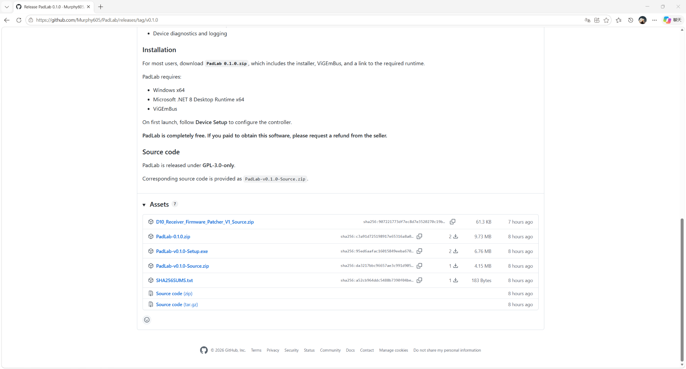

---

# 2. Download USB Device Tree Viewer

Download **USB Device Tree Viewer (UsbTreeView)** from the author's website:

**https://www.uwe-sieber.de/usbtreeview_e.html#download**

For a normal 64-bit Windows PC, download the **x64** build.

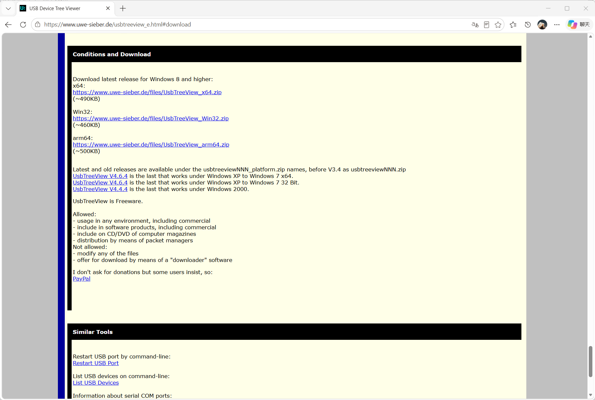

Extract the downloaded archive and run `UsbTreeView.exe` when instructed later in this guide.

---

# 3. Wired mode only: verify the D10 VID/PID

This pre-check is required for the **wired setup path only**.

If you are setting up **2.4 GHz mode**, skip this section. The receiver will be verified in UsbTreeView **after** the V0.5ae receiver firmware has been created and flashed in Section 12.

For wired mode, connect the EasySMX D10 to the PC **with a USB cable** while it is still using the normal Windows driver.

Open UsbTreeView and locate the controller. Confirm that it reports:

```text
Vendor ID  : 0x045E
Product ID : 0x028E
```

In other words:

```text
VID_045E
PID_028E
```

The device may appear as **Xbox 360 for Windows Controller** in Windows.

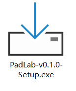

> **Do not change any driver in UsbTreeView.**
>
> In wired mode, UsbTreeView is used here only to confirm the controller VID/PID before PadLab Device Setup.

---

# 4. Install the required components

Extract `PadLab-0.1.0.zip`.

## 4.1 Install Microsoft .NET 8 Desktop Runtime

Open:

```text
PadLab_Download_NET8_Desktop_Runtime.html
```

Use the page to download and install **Microsoft .NET 8 Desktop Runtime (Windows x64)**.

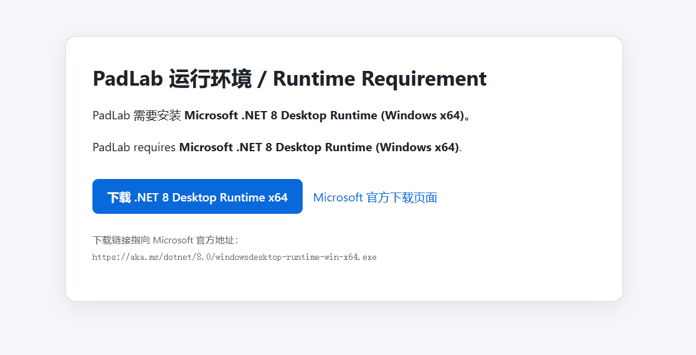

## 4.2 Install ViGEmBus

Run:

```text
ViGEmBus_1.22.0_x64_x86_arm64.exe
```

and complete the installation.

## 4.3 Install PadLab

Run:

```text
PadLab-v0.1.0-Setup.exe
```

and complete the PadLab installation.

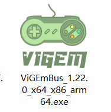

If you choose to create a desktop shortcut during setup, you can launch PadLab from the desktop afterward.

---

# 5. Choose your connection path

## Wired USB

No receiver firmware step is required. Continue with **Section 6 — Open Device Setup in PadLab**.

## 2.4 GHz receiver

Skip to **Section 12 — 2.4 GHz: prepare and flash the receiver first**.

After the receiver firmware step is complete, the 2.4 GHz path returns to the same Device Setup and calibration workflow used by the wired path.

---

# 6. Open Device Setup in PadLab

Launch PadLab.

Before first-time setup is complete, the main window may show the controller or service as unavailable and may warn that the current driver state must be completed through Device Setup.

Open:

**App Settings → Open Device Setup**

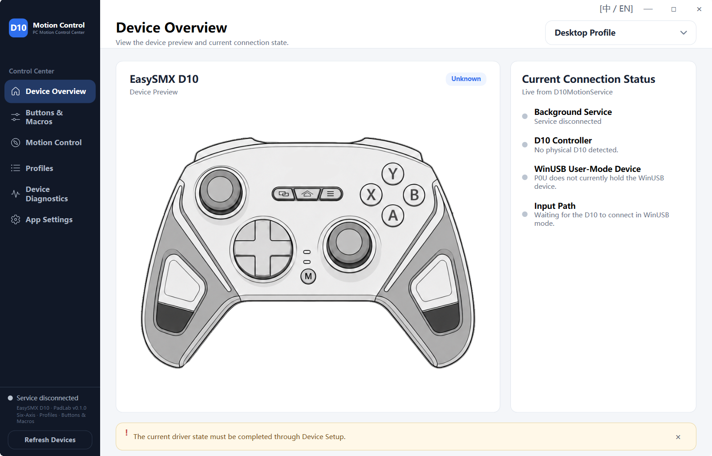

For normal first-time setup, use **Device Setup**, not **Emergency Toolbox**.

---

# 7. First-time Device Setup

PadLab confirms the physical target by watching it disappear when unplugged and reappear when reconnected.

This same workflow is used for both:

- a **wired D10**, and
- a **2.4 GHz receiver**.

> **2.4 GHz note**
>
> The screenshots in this section were captured with a wired D10. When using the 2.4 GHz receiver, follow the same steps but unplug/reconnect the **receiver** instead of the wired controller.
>
> Candidate IDs shown in the screenshots are examples only and may be different on your system.

## 7.1 Start first-time setup

Device Setup should show a detected candidate device.

Click:

**Start first-time setup**

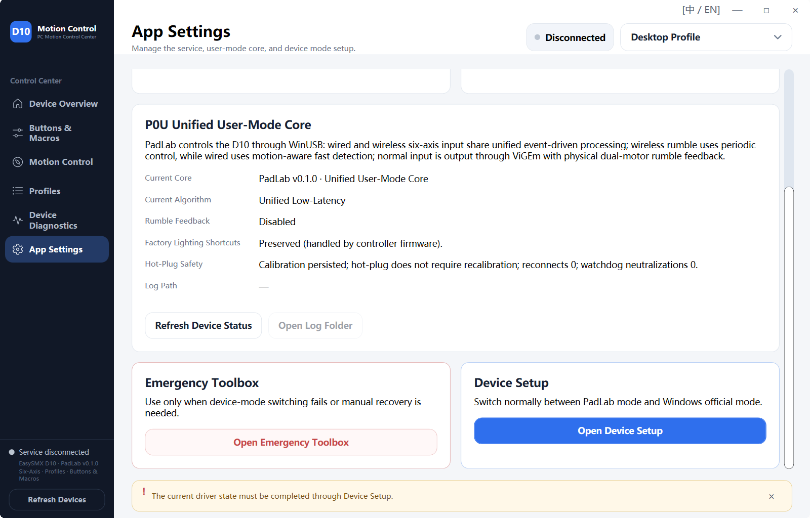

## 7.2 Unplug the target device

Wait until the page shows:

**Waiting for unplug**

Then unplug the device you want to configure:

- unplug the **wired D10** in wired mode, or
- unplug the **2.4 GHz receiver** in wireless mode.

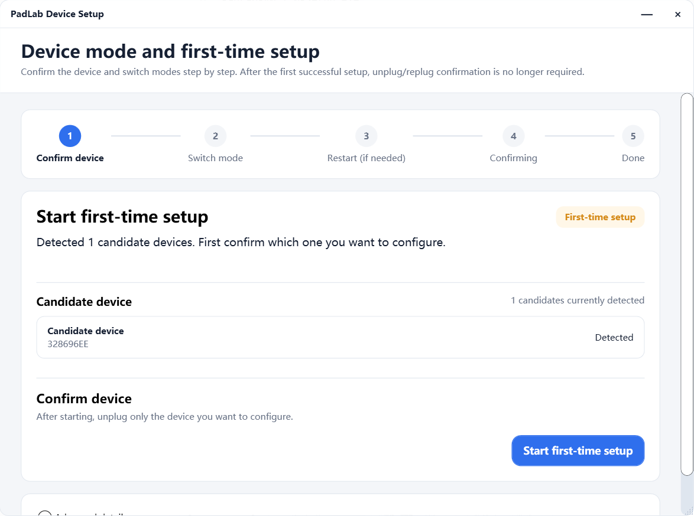

## 7.3 Reconnect the same device

After PadLab identifies the device that disappeared, the page will show:

**The unplugged device was identified**

and:

**Waiting for reconnect**

Reconnect the **same device** you just unplugged.

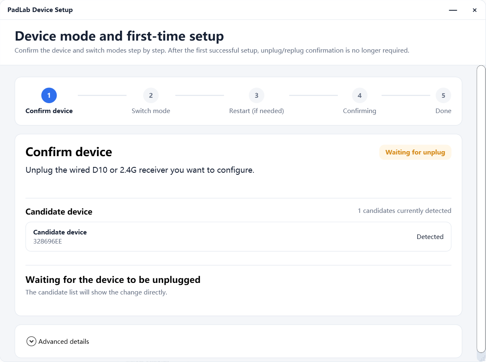

## 7.4 Confirm the reconnected device

When PadLab detects the same device again, the page will show:

**The unplugged device has been detected again**

and the candidate will be marked **Detected again**.

Click:

**Confirm and continue**

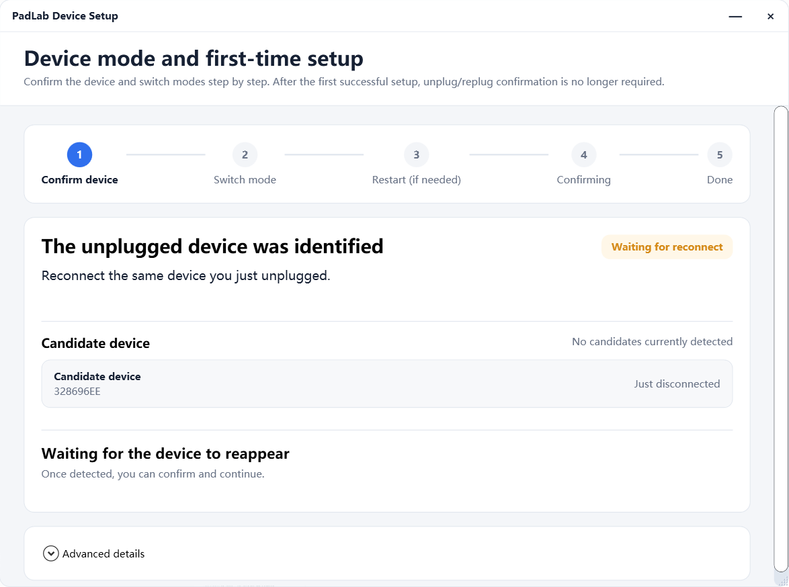

## 7.5 Switch to PadLab mode

After confirmation, Device Setup should show:

```text
Current mode: Windows official mode
```

Click:

**Switch to PadLab mode**

Windows may request administrator permission. Allow it to continue.

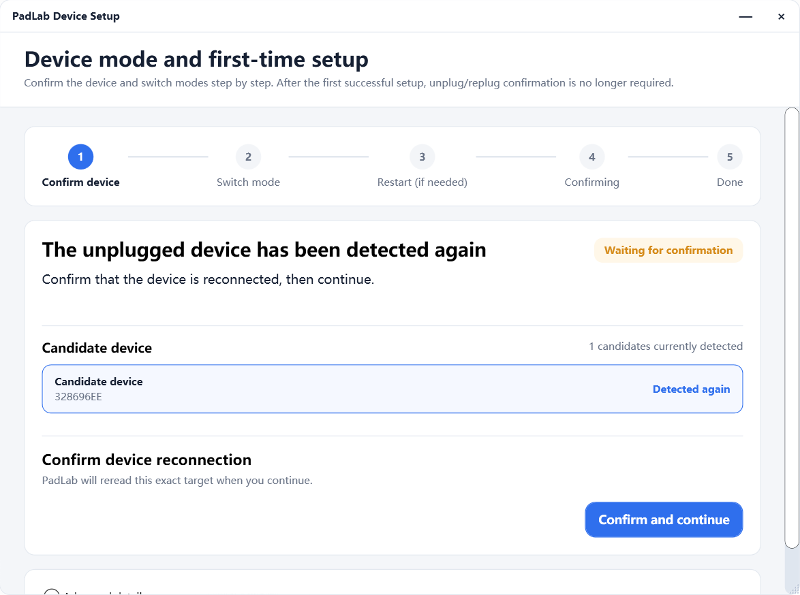

PadLab will process the driver-mode switch.

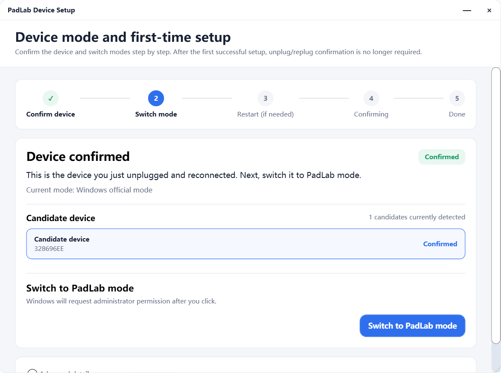

While this step is processing, do not unplug the target device or close PadLab.

## 7.6 Restart Windows

If Device Setup shows:

**Windows restart required**

click:

**Restart Windows now**

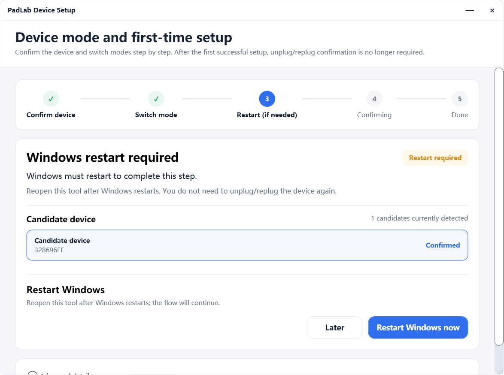

After Windows restarts, you do **not** need to repeat the unplug/replug confirmation.

---

# 8. Confirm that PadLab mode is ready

After Windows restarts, launch PadLab again.

Device Setup should resume and eventually show:

```text
PadLab mode is ready.
Current mode: PadLab mode · Ready
```

with the status:

**Ready**

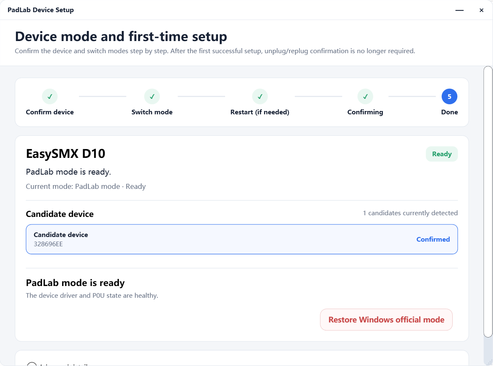

You can now close Device Setup.

In wired mode, Device Overview should show a wired input path such as:

```text
USB wired / EP83
```

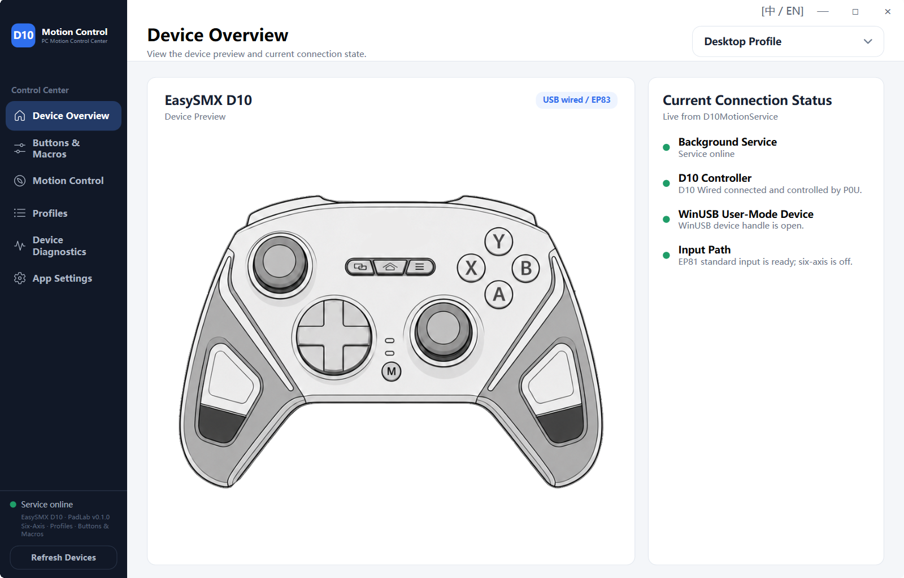

In 2.4 GHz mode, the connection label will show the corresponding **2.4G** connection instead. The exact connection label is different, but the setup state and next steps are the same.

At this point, PadLab mode is working, but six-axis motion may still be disabled. The one-time hardware calibration is the next step.

---

# 9. Perform the one-time 3-axis hardware calibration

Open:

**Motion Control**

Before calibration, the page should show a state similar to:

```text
Connected; six-axis disabled
```

For a wired controller, click:

**Calibrate wired three-axis hardware**

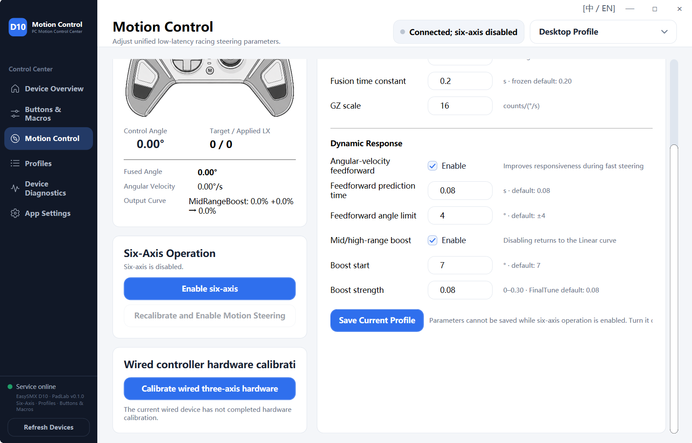

For a 2.4 GHz connection, the corresponding entry is labeled:

**Calibrate 2.4G three-axis hardware**

> **2.4 GHz note**
>
> The screenshots below use the wired calibration UI as the example. The 2.4 GHz calibration process is the same; only the connection label and hardware-calibration entry change from **Wired** to **2.4G**.

## 9.1 Read the calibration instructions

PadLab guides you through **15 stationary poses**.

Click:

**Start Calibration**

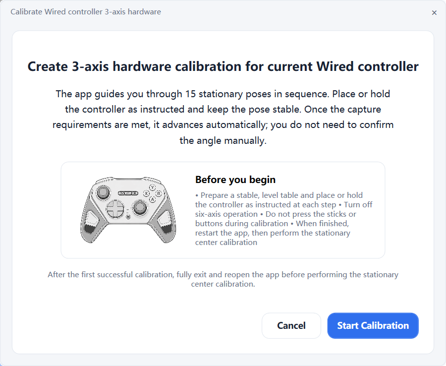

During the 15 poses:

- Follow the direction shown on screen.
- Keep the controller stable for each pose.
- You do **not** need to match an exact angle manually.
- Direction and stability are more important than trying to reach a mathematically perfect angle.
- Do not press the sticks or buttons during capture.
- PadLab automatically determines when the controller is stable enough.
- Once a pose is captured successfully, PadLab automatically advances to the next pose.

For example, the first pose is **Baseline flat**:

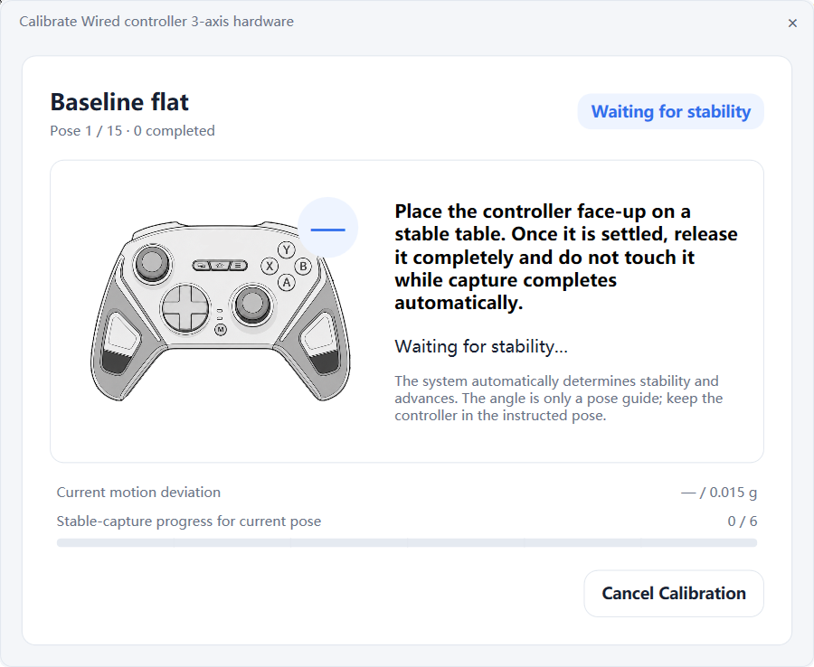

If a pose does not complete, reposition the controller as instructed and let it become stable again.

## 9.2 Finish hardware calibration

After all 15 poses are completed, PadLab saves the hardware calibration.

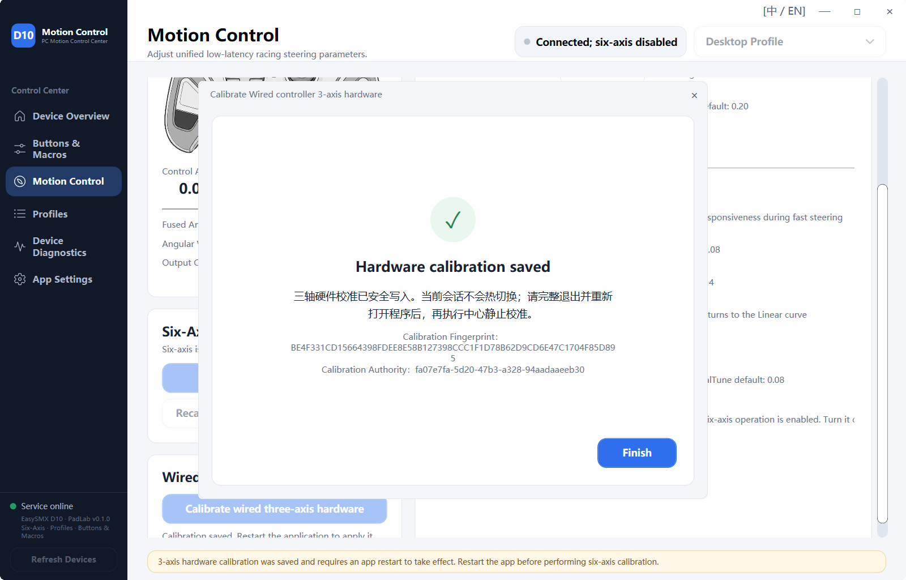

> **PadLab 0.1.0 localization note**
>
> The confirmation dialog in this release contains one Chinese status sentence that was not translated. The calibration itself is still saved normally. This is a known localization issue planned for a later version.

In normal use, this hardware calibration only needs to be performed once. As long as the calibration file remains available, you normally do not need to repeat the 15-pose hardware calibration every time PadLab starts.

---

# 10. Fully exit and reopen PadLab

After the first successful hardware calibration, **fully exit PadLab and reopen it** before performing the stationary gyroscope calibration.

When PadLab asks what should happen when the main window is closed, choose:

**Exit application**

Do **not** choose **Minimize application** for this step.

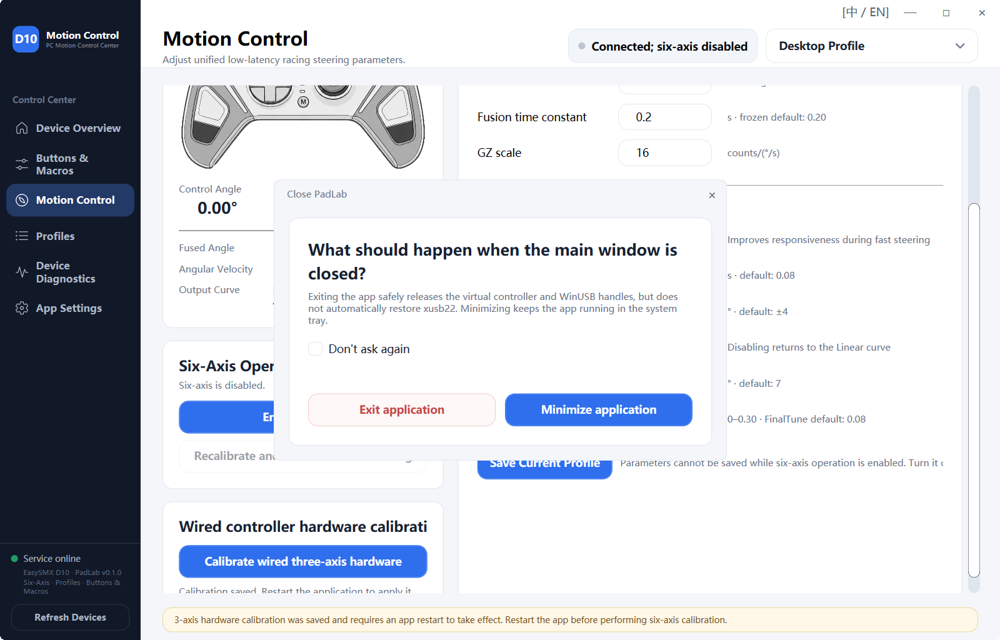

Launch PadLab again after it has fully exited.

---

# 11. Recalibrate the gyroscope and enable motion steering

Return to:

**Motion Control**

The hardware-calibration section should now indicate that the saved hardware calibration is loaded for the current connection.

Click:

**Recalibrate and Enable Motion Steering**

Place the controller **level on a stable table** and keep it completely still, then continue.

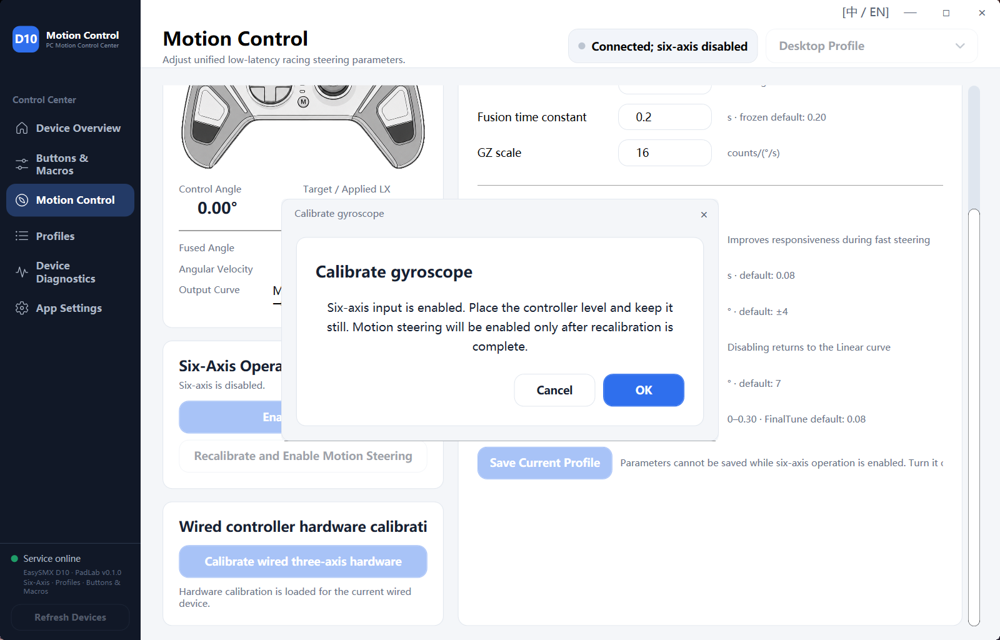

During recalibration:

- do not touch the controller,
- do not move the sticks,
- do not press any buttons.

PadLab will show the calibration progress automatically.

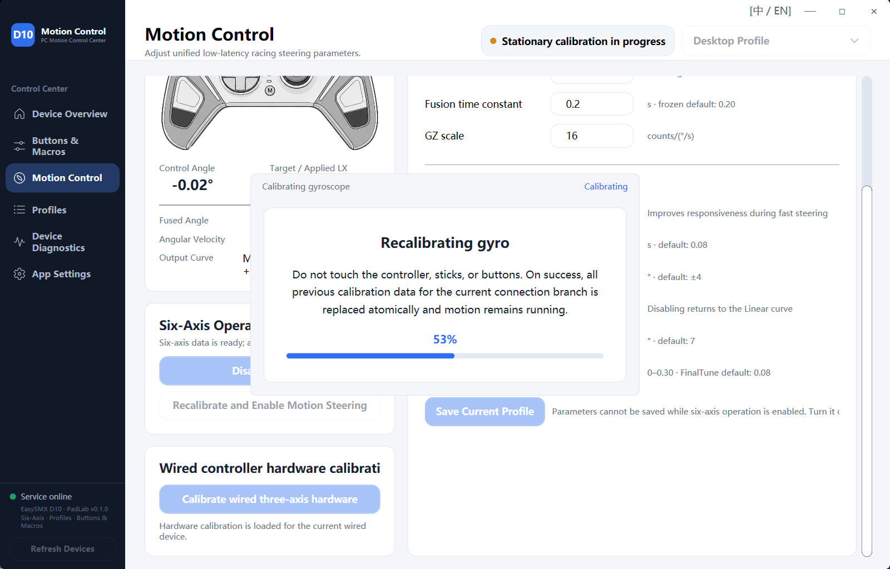

When calibration succeeds, Motion Control should show:

```text
Six-axis enabled; motion control running
```

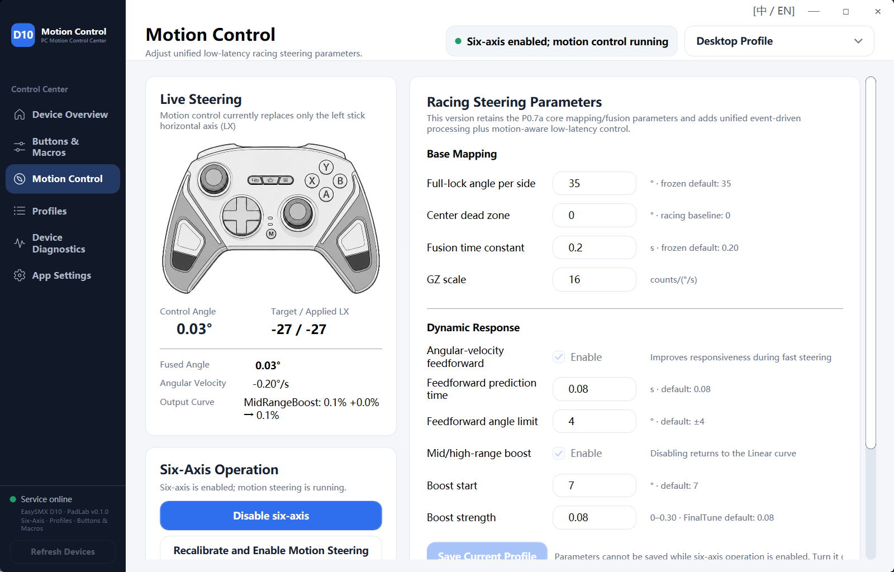

Your D10 is now ready to use with PadLab motion steering.

---

# 12. 2.4 GHz: prepare and flash the receiver first

This section is required **only if you want to use the D10 through its 2.4 GHz receiver**.

If you are using the controller through USB only, you can ignore this entire section.

> **Important**
>
> This firmware process applies only to the **2.4 GHz receiver**. The D10 controller itself does **not** need to be flashed.
>
> If you do not want to flash the receiver firmware, use the wired path instead.

## 12.1 Open the D10 Receiver Firmware Patcher

Inside the extracted PadLab 0.1.0 package, open:

```text
Receiver Firmware Patcher\D10_Receiver_Firmware_Patcher.exe
```

Switch the patcher UI to **English** if necessary.

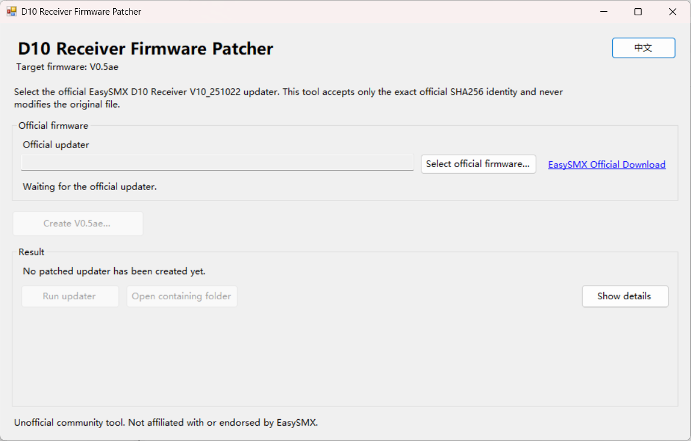

The patcher targets receiver firmware **V0.5ae** and requires the exact supported official EasySMX receiver updater as its source file.

## 12.2 Download the official EasySMX receiver updater

In the patcher, click:

**EasySMX Official Download**

Download:

```text
EasySMX D10 Receiver_V10_251022.exe
```

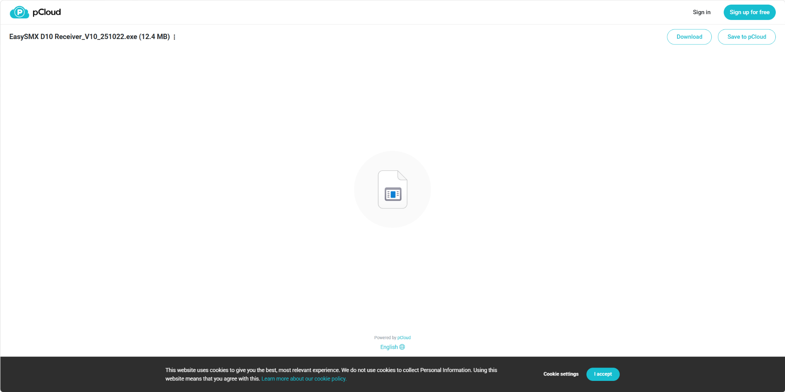

PadLab does not redistribute the official EasySMX firmware. The official file must be downloaded separately before the patcher can create the PadLab-compatible updater.

## 12.3 Select and verify the official firmware

Return to the patcher and click:

**Select official firmware...**

Select:

```text
EasySMX D10 Receiver_V10_251022.exe
```

When the exact supported official updater is selected, the patcher should show a green verification message:

```text
Official updater verified: EasySMX D10 Receiver_V10_251022
```

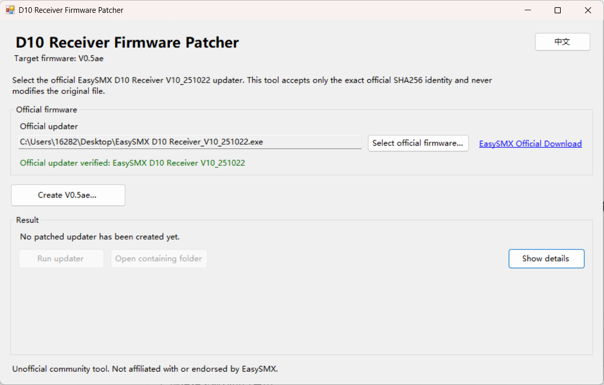

### If you select the wrong file

You do not need to guess whether a different file is acceptable.

The patcher checks the supported official source identity. An unsupported file is rejected and the patcher reports that no file was modified.

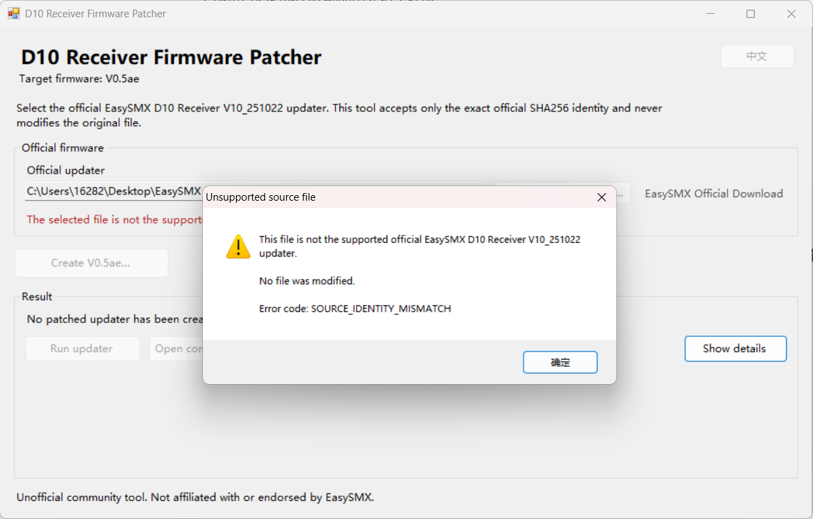

If you see an error such as:

```text
SOURCE_IDENTITY_MISMATCH
```

select the correct official `EasySMX D10 Receiver_V10_251022.exe` file instead.

## 12.4 Create the V0.5ae updater

Click:

**Create V0.5ae...**

Choose where to save the generated updater.

The default filename is similar to:

```text
D10_Receiver_V10_251022_0.5ae_UNOFFICIAL.exe
```

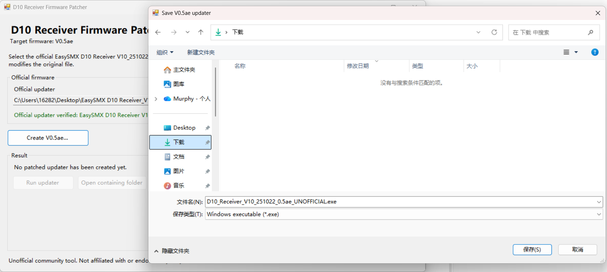

Wait for the patcher to create and re-verify the generated updater.

When successful, the patcher reports:

```text
V0.5ae was created and re-verified successfully.
The original official updater was not modified.
```

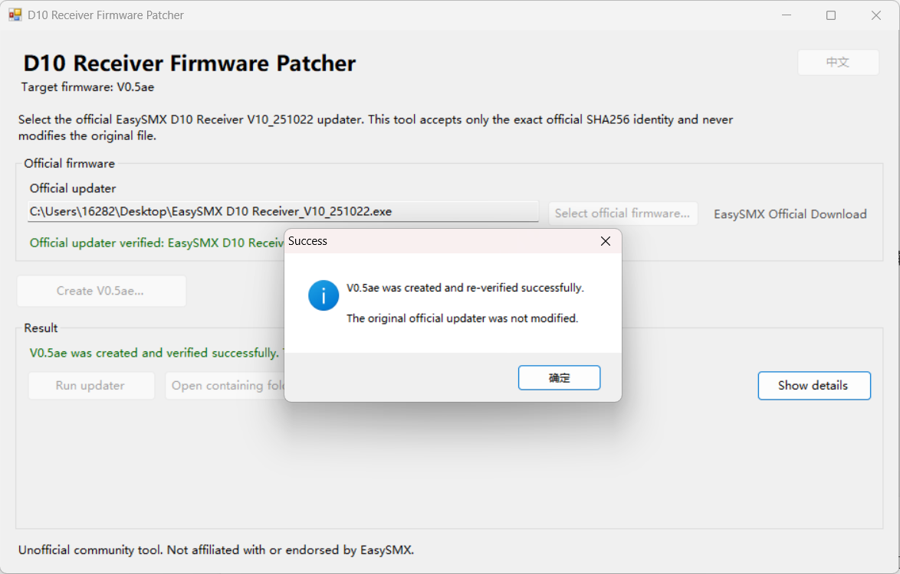

After closing the success message, the patcher should also show the generated result as verified.

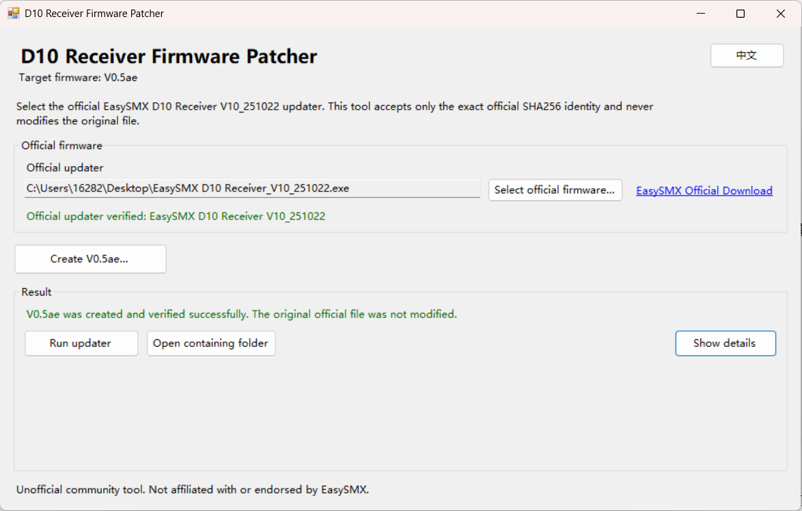

## 12.5 Run the generated updater

Click:

**Run updater**

The EasySMX updater window will open as:

```text
BT Dongle F/W Update Tool V1.0
```

At first, it may show:

```text
Device Status: OFFLINE
```

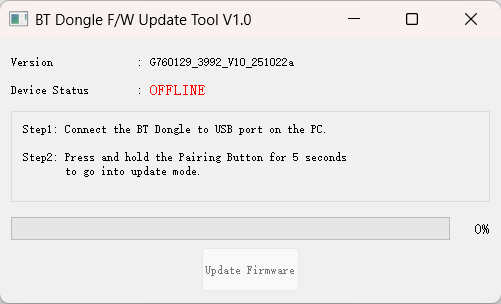

## 12.6 Put the receiver into update mode

Keep the receiver connected to the PC.

Press and hold the receiver's **Pairing Button for about 5 seconds**.

The updater itself instructs:

```text
Press and hold the Pairing Button for 5 seconds
to go into update mode.
```

Wait until the receiver enters update mode and the updater changes from **OFFLINE** to **ONLINE**.

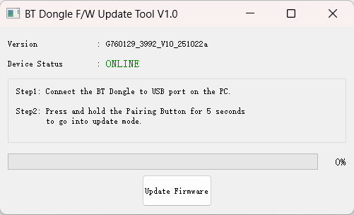

Do not click **Update Firmware** until the updater shows **ONLINE**.

## 12.7 Flash the receiver firmware

When the updater shows **ONLINE**, click:

**Update Firmware**

Do not unplug the receiver while the update is in progress.

Wait until the updater reports:

```text
SUCCESS
100%
```

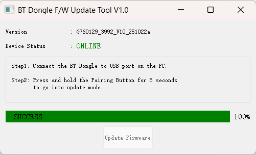

After success:

1. Close the updater.
2. Unplug the receiver once.
3. Plug the receiver back into the PC.

## 12.8 Verify the receiver VID/PID in UsbTreeView

Open UsbTreeView and locate the reconnected receiver.

Confirm:

```text
Vendor ID  : 0x045E
Product ID : 0x028E
```

or:

```text
VID_045E
PID_028E
```

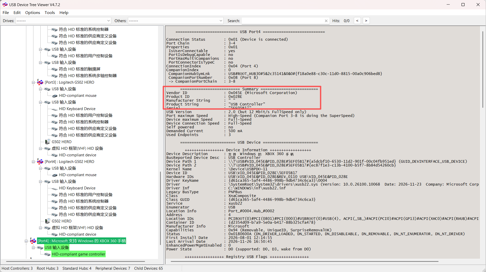

This check confirms the USB identity after the receiver firmware step. It does **not** mean the receiver is already in PadLab mode.

---

# 13. Continue 2.4 GHz setup using the same PadLab flow

After the receiver firmware has been flashed successfully, replugged, and verified as `VID 045E / PID 028E`, continue with the same PadLab workflow shown earlier in this guide:

1. Open **App Settings → Open Device Setup**.
2. Click **Start first-time setup**.
3. When PadLab shows **Waiting for unplug**, unplug the **2.4 GHz receiver**.
4. When PadLab identifies the unplugged device, reconnect the same receiver.
5. Click **Confirm and continue** after it is detected again.
6. Click **Switch to PadLab mode**.
7. Allow administrator permission if Windows asks.
8. Restart Windows when Device Setup requests it.
9. Reopen PadLab and confirm Device Setup shows **Ready**.
10. Open **Motion Control**.
11. Run **Calibrate 2.4G three-axis hardware**.
12. Complete the same 15 stationary poses shown in Section 9.
13. Fully **Exit application** and reopen PadLab.
14. Run **Recalibrate and Enable Motion Steering** with the controller level and completely still.
15. Wait until PadLab shows **Six-axis enabled; motion control running**.

The screenshots in Sections 7–11 use the wired D10 as the example. In 2.4 GHz mode, the workflow is the same; the visible connection label and hardware-calibration entry will show **2.4G** instead of **Wired**.

---

# Quick summary

## Wired first-time setup

1. Download `PadLab-0.1.0.zip` and UsbTreeView.
2. Connect the D10 by USB and confirm `VID_045E / PID_028E` in UsbTreeView.
3. Install .NET 8 Desktop Runtime, ViGEmBus, and PadLab.
4. Open **App Settings → Open Device Setup**.
5. Complete unplug/replug confirmation.
6. Switch to **PadLab mode**.
7. Restart Windows when requested.
8. Confirm Device Setup shows **Ready**.
9. Run **Calibrate wired three-axis hardware**.
10. Complete all 15 stationary poses.
11. Fully exit and reopen PadLab.
12. Run **Recalibrate and Enable Motion Steering** with the controller level and still.
13. Confirm **Six-axis enabled; motion control running**.

## 2.4 GHz first-time setup

1. Download `PadLab-0.1.0.zip` and UsbTreeView.
2. Install .NET 8 Desktop Runtime, ViGEmBus, and PadLab.
3. Open `Receiver Firmware Patcher\D10_Receiver_Firmware_Patcher.exe`.
4. Download the exact official `EasySMX D10 Receiver_V10_251022.exe` through **EasySMX Official Download**.
5. Select the official firmware and confirm that it is verified.
6. Click **Create V0.5ae...** and save the generated updater.
7. Click **Run updater**.
8. Hold the receiver Pairing Button for about 5 seconds until the updater shows **ONLINE**.
9. Click **Update Firmware** and wait for **SUCCESS 100%**.
10. Unplug and reconnect the receiver.
11. **Now** open UsbTreeView and confirm that the flashed receiver reports `VID_045E / PID_028E`. No pre-flash VID/PID check is required for the 2.4 GHz path.
12. Continue with the same Device Setup flow used by the wired path.
13. Run **Calibrate 2.4G three-axis hardware**.
14. Complete the same 15 stationary poses.
15. Fully exit and reopen PadLab.
16. Run **Recalibrate and Enable Motion Steering**.
17. Confirm **Six-axis enabled; motion control running**.
---

# Notes

- The D10 **controller itself never needs to be flashed** for this guide.
- Only the **2.4 GHz receiver** uses the V0.5ae receiver-firmware step.
- Wired mode does **not** require receiver firmware flashing.
- UsbTreeView is used only to verify the device VID/PID. Do not use it to change drivers.
- The 15-pose 3-axis hardware calibration is normally a one-time setup for that connection/device as long as its calibration data remains available.
- The stationary gyroscope calibration is separate from the one-time 15-pose hardware calibration.
- After the first hardware calibration is saved, fully exit PadLab rather than minimizing it before reopening the app for stationary gyroscope calibration.
- PadLab 0.1.0 is an early release. If something does not behave as described, report the issue with your Windows version, connection type, reproduction steps, and useful screenshots or logs.

---

# Project links

PadLab GitHub:  
**https://github.com/Murphy605/PadLab**

PadLab 0.1.0 release:  
**https://github.com/Murphy605/PadLab/releases/tag/v0.1.0**

Bug reports:  
**https://github.com/Murphy605/PadLab/issues**
